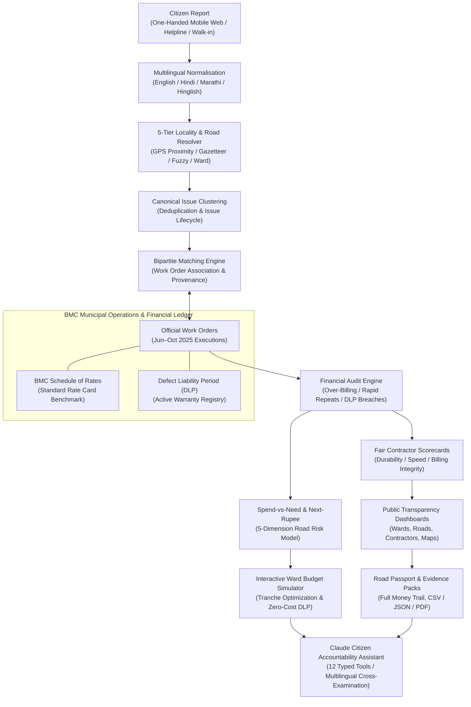

# Rasta Hisaab 2.0 (रास्ता हिसाब)

> **Follow the Rupee across Mumbai's monsoon roads.**  
> Evidence-First Civic Intelligence & Municipal Road Repair Accountability Platform connecting citizen pothole reports directly to municipal repair budgets, official work orders, contractor scorecards, and warranty enforcement across all 24 BMC wards.  
> **Official Repository:** `https://github.com/di0206-innovator/claude-impact-labs---my-version.git`

[](https://github.com/di0206-innovator/claude-impact-labs---my-version/actions/workflows/ci.yml)
[](https://nextjs.org/)
[](https://react.dev/)
[](https://www.typescriptlang.org/)
[-729b1b?style=flat-square&logo=vitest)](https://vitest.dev/)
[](src/test/line-limit.test.ts)
[](https://ux4g.gov.in/)
[](https://maplibre.org/)
[-d97706?style=flat-square&logo=anthropic)](https://www.anthropic.com/)
[](https://aws.amazon.com/dynamodb/)
[-blueviolet?style=flat-square)](src/app/privacy/page.tsx)

---

## 🏛️ Executive Summary & The Mumbai Monsoon Reality

Every monsoon season, the roads of Mumbai undergo severe structural breakdown. The Brihanmumbai Municipal Corporation (BMC) allocates hundreds of crores of public rupees to emergency road repairs, pothole filling, mastic asphalt reinstatement, and paver block repairs. Yet, year after year:

1. **The Accountability Chasm:** Citizen complaints registered via helplines or mobile portals vanish into administrative queues without public visibility into which contractor was assigned, how much money was billed, or whether the repair held up.
2. **The Repeat-Repair Loop:** Potholes filled in July frequently wash away by August, resulting in duplicate work orders billed to the municipal exchequer for the exact same road segment.
3. **Unenforced Warranties:** Roads legally covered under multi-year **Defect Liability Periods (DLP)**—where contractors are contractually obligated to fix failures at zero cost—are repeatedly billed as fresh emergency repairs.

**Rasta Hisaab 2.0 (रास्ता हिसाब)** solves this systemic breakdown. Engineered for citizens, civic activists, ward officers, and municipal leadership, Rasta Hisaab follows every single rupee from budgetary allocation to the physical asphalt on the street.

---

## 🔄 End-to-End System Architecture



---

## 🌟 Core Platform Capabilities

### 1. 🗺️ Road Passport & Forensic Evidence Dossiers (`/roads/[roadId]`)
- **Reliability Profile:** Complete digital passport for 291 Mumbai road alignments across all 24 wards.
- **Money Trail:** Visualizes the full financial trail—every citizen signal, work order issued, contractor assigned, amount billed, and durability outcome.
- **Lifecycle Auditing:** Explicit state tracking across `Signal Logged` $\to$ `Work Order Issued` $\to$ `Job Completed` $\to$ `Held Up / Failed`.
- **Evidence Packs (`/roads/[roadId]/evidence`):** 1-click forensic dossiers for administrative review, citizen RTI (Right to Information) filings, and ward committees.
- **Direct Exports:** Programmatic evidence downloads via `/api/roads/[id]/evidence.json` and `/api/roads/[id]/evidence.csv`.

### 2. ⚖️ Procurement & Accountability Engine (`/accountability`)
Deterministic, rule-based screening evaluating all municipal work orders against four strict municipal audit checks:

```
┌────────────────────────────────────────────────────────────────────────────────────────┐
│ 1. RATE CARD PRICE GOUGING                                                             │
│    Billed Amount > 1.35 × (Repair Quantity × BMC Rate Card Unit Benchmark)              │
│    Flags contracts where unit billing exceeds standard municipal schedules by >35%.   │
├────────────────────────────────────────────────────────────────────────────────────────┤
│ 2. RAPID DUPLICATE BILLING (GHOST REPAIRS)                                             │
│    Identical Road ID + Same Repair Method billed within 7 days of previous completion, │
│    without an intervening citizen complaint logged in the interim.                     │
├────────────────────────────────────────────────────────────────────────────────────────┤
│ 3. DEFECT LIABILITY PERIOD (DLP) WARRANTY DOUBLE-BILLING                               │
│    Fresh BMC payment billed for a road segment currently covered under an active       │
│    contractor warranty. Contractor is legally required to repair at ZERO cost.        │
├────────────────────────────────────────────────────────────────────────────────────────┤
│ 4. POST-COMPLETION PHANTOM BURSTS                                                      │
│    A sudden cluster of new citizen complaints registered on a road within 7 days of    │
│    a contractor recording official job completion.                                     │
└────────────────────────────────────────────────────────────────────────────────────────┘
```

### 3. 📊 Spend-vs-Need & Next-Rupee Prioritisation (`/spend-vs-need`, `/budget`)
Rather than allocating funds via political discretion or arbitrary quotas, Rasta Hisaab computes an objective, multi-criteria risk rating for every road:

$$\text{Risk Score} = 0.30 \cdot C_{\text{open}} + 0.25 \cdot R_{\text{reopen}} + 0.15 \cdot A_{\text{accidents}} + 0.15 \cdot F_{\text{flood}} + 0.10 \cdot T_{\text{traffic}} + 0.05 \cdot S_{\text{facility}}$$

- **Transparent 5-Dimension Model:** Eliminates opaque black-box scores by displaying explicit contributions for open complaints, repeat failure history, accident severity, flood vulnerability, and traffic/emergency transit density.
- **Fiscal Equity & Ward Disparity (`/budget`):** Identifies underfunded wards experiencing acute road distress compared to heavily funded wards.
- **Interactive Budget Simulator:** Dynamically test funding tranches (₹25 Lakh, ₹50 Lakh, ₹1 Crore, Full Budget).
- **The Zero-Cost DLP Advantage:** Roads under active Defect Liability are prioritized for immediate repair enforcement notice at **₹0 cost to the ward budget**, conserving public funds.

### 4. 📱 Mobile-First Citizen Reporting & Tracking Flow (`/`, `/report`, `/citizen`, `/track`, `/verify`)
- **Street-Optimized Ergonomics:** Designed for one-handed mobile use on Mumbai streets.
- **Client-Side Photo Compression:** Canvas-based client compression strips GPS metadata, shrinks images before transmission, and avoids network timeouts on 3G/4G connections.
- **5-Tier Locality & Road Resolver:**
  1. *Tier 1:* High-accuracy GPS proximity via Turf.js geodesic calculations ($\le 50\text{m}$).
  2. *Tier 2:* Exact locality lookup (`localities.csv`).
  3. *Tier 3:* Phonetic and fuzzy alias matching for colloquial street names.
  4. *Tier 4:* Ward boundary polygon containment.
  5. *Tier 5:* Unresolved fallback with explicit provenance tracking.
- **Spatiotemporal Deduplication:** Groups nearby reports into canonical issues, preventing administrative clutter while preserving each citizen's individual submission receipt (`/receipt/[id]`).

### 5. 🤖 Claude Citizen Accountability Assistant (`/assistant`)
- **Server-Only Sandboxed AI:** Conversational cross-examination powered by Anthropic Claude 3.5 Sonnet / Haiku.
- **"Claude Explains, It Does Not Count":** Claude has zero raw SQL access, zero database mutation rights, and cannot approve payments or file official complaints. All financial sums are calculated deterministically in TypeScript.
- **12 Typed Read-Only Tools:**
  1. `get_complaint(complaint_id)`: Inspect original citizen complaint details.
  2. `get_canonical_issue(issue_id)`: Inspect clustered canonical civic issue.
  3. `get_road_details(road_id)`: Fetch road length, surface type, lanes, and DLP status.
  4. `get_work_orders(road_id, ward_code)`: Query historical work orders and billed costs.
  5. `get_contractor_details(contractor_id)`: Retrieve contractor grade, jobs, and audit flags.
  6. `get_issue_timeline(issue_id)`: Complete audit chronology from report to repair.
  7. `get_source_evidence(reference_id)`: Examine raw provenance records and ground truths.
  8. `get_next_steps(issue_id)`: Actionable recommendations for citizen follow-up.
  9. `get_contractor_rankings()`: League table of contractor scorecard metrics.
  10. `get_ward_summary(ward_code)`: Financial summary and spend vs budget by ward.
  11. `get_audit_flags(ward_code, type)`: List active municipal audit red-flags.
  12. `get_next_rupee_plan(ward_code)`: Next-rupee road prioritisation rank order.
- **Structured Schema & Multilingual:** Responses validated for Direct Answer, Official Records, Timeline, Unresolved Questions, Citizen Next Steps, and Sources Examined. Supports English, Hindi, Marathi, and Hinglish with automatic deterministic offline fallback.

### 6. 🏆 Fair Contractor Scorecards (`/contractors`, `/contractors/[id]`)
- **Method & Stress-Level Baselines:** Benchmarked against citywide averages for the *exact same repair method* (Cold Mix, Mastic Asphalt, Paver Blocks, Micro-surfacing) under the *same road stress category*.
- **Standardized Score Scale (0–100):** Median at 50; scores below 35 highlight severe repeat failures or excessive billing markups.
- **Bayesian Shrinkage:** Low-sample contractors (<15 jobs) are regularized toward the median of 50 with a `Limited Data` badge to prevent statistical distortion.
- **Vector PDF Scorecard (`/contractors/[id]/scorecard.pdf`):** Programmatically generated via `pdf-lib` for administrative distribution and citizen RTI filings.

---

## 💻 Developer Quickstart & Setup

### Prerequisites
- **Node.js 20+** (`node -v` $\ge$ 20.0.0)
- **npm 10+**
- **Git**

### 1. Clone the Repository
```bash
git clone https://github.com/di0206-innovator/claude-impact-labs---my-version.git
cd claude-impact-labs---my-version
npm ci
```

### 2. Configure Git Safety Hooks
To enforce the sole authorized remote repository policy (`origin` pointing to `https://github.com/di0206-innovator/claude-impact-labs---my-version.git`), run:
```bash
npm run setup-git-hooks
```
*(Note: This is automatically executed during `npm install` / `npm ci` via the `postinstall` script).*

### 3. Run in Local In-Memory Mode (No Cloud Services Required)
Rasta Hisaab includes a zero-config in-memory persistence adapter that immediately seeds the application with sample citizen reports and the full Mumbai rupee ledger:
```bash
RASTABAAZ_REPO=memory npm run dev
```
Open [http://localhost:3000](http://localhost:3000) in your browser.

### 4. (Optional) Run with AWS DynamoDB
To connect to an AWS DynamoDB table:
1. Configure AWS credentials and set `RASTABAAZ_TABLE_NAME` in `.env.local`.
2. Deploy the table template in `infra/rastabaaz-table.yaml`.
3. Seed the database and start the server:
   ```bash
   npm run seed
   npm run dev
   ```

### 5. (Optional) Enable Claude AI Assistant
Set your Anthropic API key in `.env.local`:
```bash
ANTHROPIC_API_KEY=sk-ant-api03-...
```
*(If unset, the assistant automatically uses the deterministic offline fallback engine).*

---

## 🧪 Quality Gates & CI Verification

Rasta Hisaab 2.0 enforces a strict automated quality gate pipeline that must pass before any commit:

```bash
npm run ci
```

Or execute the individual stages:
```bash
# 1. Verify strict 300-line cap across all ts/tsx/css/mjs source files
npm run test:lines

# 2. TypeScript strict typecheck
npm run typecheck

# 3. ESLint code quality & security audit
npm run lint

# 4. Vitest automated test suite (117 test files, 610 tests)
npx vitest run

# 5. Production Next.js 15 SSR build
npm run build
```

---

## ⚙️ Environment Variables Reference

| Variable | Scope | Required | Default | Description |
| :--- | :--- | :---: | :---: | :--- |
| `ANTHROPIC_API_KEY` | Server | Optional | — | Anthropic API key for Claude assistant and contractor summaries. |
| `ANTHROPIC_MODEL` | Server | Optional | `claude-sonnet-4-5` | Primary model for assistant reasoning. Falls back to `claude-haiku-4-5`. |
| `RUPEE_CONTRACTOR_MODEL`| Server | Optional | `claude-haiku-5-5` | Model for contractor executive narrative generation. |
| `RUPEE_PHANTOM_FLAG` | Server | Optional | `0` | Set to `1` to activate post-completion complaint burst audit check. |
| `RASTABAAZ_REPO` | Server | Optional | `dynamodb` | Set to `memory` for zero-dependency local in-memory execution. |
| `RASTABAAZ_TABLE_NAME` | Server | Production | — | Amazon DynamoDB single-table name. |
| `AWS_REGION` | Server | Production | `ap-south-1` | AWS Region for DynamoDB operations. |
| `DYNAMODB_ENDPOINT` | Server | Optional | — | Custom endpoint for local DynamoDB emulator (e.g., `http://localhost:8000`). |
| `ADMIN_KEY` | Server | Required | — | Secret key for accessing `/admin` civic desk and review queues. |
| `NEXT_PUBLIC_SITE_URL` | Client | Optional | `http://localhost:3000` | Fully qualified base URL for Open Graph and Twitter metadata. |

---

## 📜 NPM Script Commands

| Command | Purpose |
| :--- | :--- |
| `npm run dev` | Starts Next.js development server with Turbopack. |
| `npm run build` | Compiles production Next.js build, optimizes assets, and generates static pages. |
| `npm start` | Launches Next.js production server. |
| `npm run typecheck` | Executes `tsc --noEmit` to verify strict TypeScript typing. |
| `npm run lint` | Runs ESLint across all source code. |
| `npm test` | Runs the full Vitest automated test suite (117 test files, 610 tests). |
| `npm run test:lines` | **Architectural Guardrail:** Fails if any `.ts`, `.tsx`, `.css`, or `.mjs` file exceeds 300 lines. |
| `npm run ci` | Complete quality gate: `test:lines && typecheck && lint && vitest && build`. |
| `npm run setup-git-hooks` | Configures `.githooks/pre-push` remote whitelist safety barrier. |
| `npm run seed` | Seeds configured database (Memory or DynamoDB) with synthetic baseline reports. |
| `npm run amplify:env` | Generates `.env.production` during AWS Amplify CI/CD deployments. |
| `npm run iam:policy` | Renders a least-privilege, table-scoped IAM policy for cloud compute roles. |

---

## 📂 Repository Structure

```
├── .github/workflows/ci.yml       # GitHub Actions CI workflow (quality gates)
├── .githooks/pre-push             # Git hook enforcing sole authorized remote origin
├── data/rupee/                    # Synthetic civic dataset (15 CSVs + 2 GeoJSONs)
│   ├── DATA_DICTIONARY.md         # Schema definitions for complaints, roads, contractors, etc.
│   ├── STARTER_IDEAS.md           # Civic accountability problem statements and use cases
│   └── [complaints, roads, wards, work_orders, contractors, traffic, ...]
├── docs/agents/                   # 10 Specialist Agent Specifications (AGENTS.md)
├── docs/orchestration_reports/    # Live orchestration reports and milestones
├── infra/                         # Cloud infrastructure definitions
│   └── rastabaaz-table.yaml       # AWS CloudFormation single-table DynamoDB template
├── scripts/                       # Tooling, build utilities, and git hook scripts
│   ├── build-geo.mjs              # GeoJSON coordinate compiler
│   ├── copy-maplibre-worker.mjs   # Standalone web worker packager for MapLibre
│   ├── setup-git-hooks.mjs        # Automated pre-push safety hook installer
│   └── write-amplify-env.ts       # Amplify cloud environment builder
├── src/
│   ├── app/                       # Next.js 15 App Router pages and API endpoints
│   │   ├── accountability/        # Procurement & audit screening intelligence
│   │   ├── assistant/             # Citizen AI accountability chat interface
│   │   ├── budget/                # Ward disparity & fiscal equity analytics
│   │   ├── contractors/           # Contractor league table and [id] dossiers
│   │   ├── map/                   # Citywide interactive GIS pin map (MapLibre GL)
│   │   ├── overview/              # Executive KPI dashboard & ward analytics
│   │   ├── places/                # Locality-specific report feeds
│   │   ├── receipt/               # Individual citizen report submission receipt
│   │   ├── reports/               # Citizen report detail view & Road Trail card
│   │   ├── roads/                 # Road Passport, money trail & evidence packs
│   │   ├── spend-vs-need/         # 5-dimension road risk prioritization & simulator
│   │   ├── track/                 # Citizen complaint status tracker
│   │   ├── verify/                # Citizen repair verification desk
│   │   └── wards/                 # Ward spend dossiers and next-rupee simulator
│   ├── components/                # Modular React 19 UI components (≤ 300 lines each)
│   │   ├── assistant/             # Chat composer, answers, and structured fact chips
│   │   ├── map/                   # MapLibre GL wrapper, layers, and interactive controls
│   │   ├── passport/              # Road Passport header, graph, money trail & evidence
│   │   ├── report/                # Step-by-step mobile report form & photo compressor
│   │   ├── rupee/                 # Budget simulator, contractor scorecard, audit lists
│   │   └── site/                  # Navigation header, footer, and government banners
│   ├── lib/                       # Domain engines and business logic
│   │   ├── assistant/             # Claude agent orchestration, typed tools, and schemas
│   │   ├── matching/              # Complaint deduplication, normalisation & road linking
│   │   ├── passport/              # Road passport services, timeline & evidence builders
│   │   ├── repo/                  # Persistence port with Memory and DynamoDB adapters
│   │   └── rupee/                 # Ledger computations, audit checks, risk scoring
│   ├── styles/                    # UX4G 3.3.3 theme extensions, motion, and ambient glass
│   └── test/                      # 117 Vitest unit, integration, and security test suites
```

---

## 🛡️ Data Disclaimers, Strict Semantics & DPDP Compliance

### Synthetic Data Disclosure
Rasta Hisaab 2.0 is powered by the synthetic Mumbai civic dataset in `data/rupee/` (11,811 verified records across 15 relational CSVs and 2 GeoJSON boundaries).
- **Authentic Geographies:** The 24 BMC ward boundaries (A through T), chronic flood hotspots, and 291 Mumbai road alignments are geographically and topographically authentic.
- **Synthetic Civic Ledger:** Financial allocations, work order identifiers, citizen submissions, and contractor names are realistic synthetic constructs created for civic technology research, municipal policy simulation, and public demonstration.

### Strict Data Semantic Invariants
To maintain uncompromising analytical integrity:
1. `work_orders.cost_inr` is strictly an **amount billed**, NEVER a confirmed municipal disbursement.
2. A completed work order represents a **recorded completion**, NEVER a physically verified repair.
3. `under_dlp` is a boolean screening indicator, NEVER a final contractual liability judgment.

### DPDP (Digital Personal Data Protection Act, 2023) Compliance
1. **Zero Personally Identifiable Information (PII):** Complainant identifiers are cryptographically hashed using SHA-256 (`citizen_hash`).
2. **Zero Contact Logging:** Raw phone numbers, email addresses, and residential identities are never stored or logged.
3. **Client-Side Photo Stripping:** Photos captured on mobile devices are stripped of EXIF and GPS metadata in the browser canvas before transmission.
4. **Server-Side Secret Isolation:** Claude API keys, DynamoDB credentials, and admin passkeys execute strictly on server runtimes and are never transmitted to client bundles.

---

## 🚀 Cloud Deployment (AWS Amplify Hosting)

Rasta Hisaab deploys seamlessly to **AWS Amplify Hosting** with full Next.js 15 SSR support:

1. Connect the GitHub repository `https://github.com/di0206-innovator/claude-impact-labs---my-version.git` in the AWS Amplify Console.
2. Select the `rasta-hisaab` (or `main`) branch.
3. Amplify automatically utilizes `amplify.yml`:
   ```yaml
   frontend:
     phases:
       preBuild:
         commands:
           - npm ci
           - npm run amplify:env
       build:
         commands:
           - npm run build
   ```
4. Configure environment variables in the Amplify Console (`RASTABAAZ_TABLE_NAME`, `ADMIN_KEY`, `ANTHROPIC_API_KEY`, `NEXT_PUBLIC_SITE_URL`).
5. Deploy and attach your custom domain.

---

## ⚖️ License & Civic Mission

This project is open-source under the **MIT License**. Built as an initiative for radical fiscal transparency, data-driven civic intelligence, and public infrastructure accountability in Mumbai.
