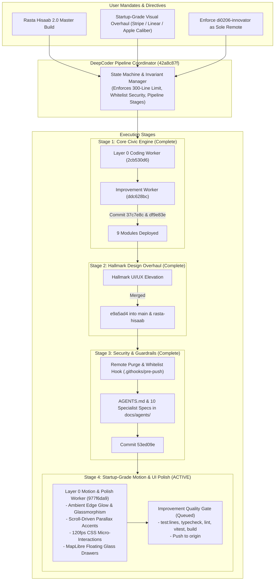

# Rasta Hisaab 2.0 — Live Master Orchestration Report

**Generated At:** 2026-11-22T22:09:00+05:30  
**Update Frequency:** Real-time & Hourly Automated Append  
**Primary Repository:** `https://github.com/di0206-innovator/claude-impact-labs---my-version.git` (`origin`)

---

## 1. Active Subagent Roster & Real-Time Status

| Agent ID | Hierarchy & Persona | Assigned Scope | Working Status | Current Activity |
|---|---|---|:---:|---|
| `42a8c87f-0204-445b-9880-d52b1b248626` | **Pipeline Coordinator** (`DeepCoder`) | Managing the 2-tier autonomous pipeline & relaying progress. | **ACTIVE** | Supervising Layer 0 motion & UI worker. |
| `977f6da9-bcd4-4d07-b59b-6a5c49be3078` | **Layer 0 UI/UX Worker** (`DeepCoderWorkerL0`) | Implementing Linear/Stripe-caliber motion, ambient lighting borders, and parallax. | **ACTIVE / IN PROGRESS** | Applying `.rb-interactive-card`, `.rb-motion-fade-in`, and card hover physics across `overview`, `passport`, `receipt`. |
| `ddc628bc-8ff1-4abd-b8a1-f8fce10a2afe` | **Improvement Worker (R2)** (`DeepCoderImprovementWorker`) | Fixed SSR serialization boundaries and rate-card calculations. | **COMPLETED** | Pushed `df9e83e` & `e9a5ad4`. |
| `86e17e1a-2c08-411e-8607-61aaab20255e` | **Remote Policy Auditor (R3)** (`DeepCoderImprovementWorker`)| Verified remote whitelist and `.githooks/pre-push` barrier. | **COMPLETED** | Verified dry-run push to `origin`. |

---

## 2. End-to-End Orchestration Architecture Flow

---

## 3. Hour-by-Hour Timeline & Execution Log

### ## Hour 1 update (2026-11-22 22:00 IST)
- **Status:** **Active execution in progress**
- **Commit Baseline:** `53ed09e` (all 99 test suites passing, line-limit $\le 300$ strictly met, zero TypeScript/ESLint errors).
- **Active Task:** Layer 0 UI/UX Worker (`977f6da9`) actively injecting:
  - Ambient glow card tokens (`.rb-interactive-card`) with subtle border luminosity.
  - Smooth entrance animations (`.rb-motion-fade-in`, `.rb-motion-stagger`).
  - Monospace tabular figures (`.rb-tabular-nums`) for currency and SLA hours.
  - Polishing `src/app/overview/page.tsx`, `src/styles/passport.css`, and `src/styles/chrome.css`.
- **Quality Gate:** Next.js 15 build, 99 test suites, and pre-push whitelist verified.
- **Estimated Completion for Startup UI/UX Overhaul:** **22:25 – 22:35 IST** (~15–25 minutes).
