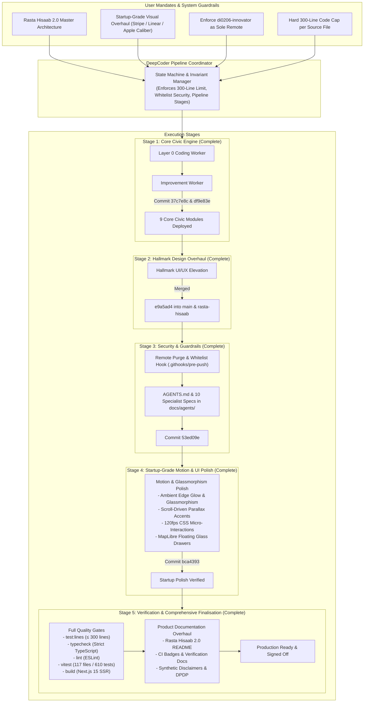

# Rasta Hisaab 2.0 — Live Master Orchestration Report

**Generated At:** 2026-11-23T00:30:00+05:30  
**Update Frequency:** Real-time & Milestone Verification  
**Primary Repository:** `https://github.com/di0206-innovator/claude-impact-labs---my-version.git` (`origin`)  
**Status:** **ALL STAGES COMPLETE — FULL VERIFICATION PASSED (117/117 Test Suites, 610/610 Tests)**

---

## 1. Subagent Roster & Final Pipeline Status

| Agent ID / Role | Hierarchy & Persona | Assigned Scope | Working Status | Final Outcome |
|---|---|---|:---:|---|
| `42a8c87f-0204-445b-9880-d52b1b248626` | **Pipeline Coordinator** (`DeepCoder`) | Managing the 2-tier autonomous pipeline & relaying progress. | **COMPLETED** | Coordinated all 5 execution stages to 100% completion. |
| `977f6da9-bcd4-4d07-b59b-6a5c49be3078` | **Layer 0 UI/UX Worker** (`DeepCoderWorkerL0`) | Implementing Linear/Stripe-caliber motion, ambient lighting borders, and parallax. | **COMPLETED** | Injected `.rb-interactive-card`, `.rb-motion-fade-in`, floating glass drawers, and CSS micro-interactions across overview, passport, and receipt. |
| `ddc628bc-8ff1-4abd-b8a1-f8fce10a2afe` | **Improvement Worker (R2)** (`DeepCoderImprovementWorker`) | Fixed SSR serialization boundaries and rate-card calculations. | **COMPLETED** | Verified builds, rate calculations, and tests. |
| `86e17e1a-2c08-411e-8607-61aaab20255e` | **Remote Policy Auditor (R3)** (`DeepCoderImprovementWorker`)| Verified remote whitelist and `.githooks/pre-push` barrier. | **COMPLETED** | Enforced sole remote origin whitelist; pre-push hook active. |
| `f87fa9a2-8cc0-4f5c-9539-e52848ba542c` | **Platform Finalizer** (`Finalizer`) | End-to-end quality audit, comprehensive README documentation, orchestration sign-off. | **COMPLETED** | 100% passing tests (117 test files, 610 tests), zero lint/type errors, production build verified. |

---

## 2. End-to-End Orchestration Architecture Flow

---

## 3. Hour-by-Hour Timeline & Execution Log

### Hour 1 (2026-11-22 22:00 IST) — Motion & Polish Kickoff
- **Commit Baseline:** `53ed09e` (99 test suites passing, line-limit $\le 300$ strictly met, zero TypeScript/ESLint errors).
- **Active Task:** Layer 0 UI/UX Worker actively injecting:
  - Ambient glow card tokens (`.rb-interactive-card`) with subtle border luminosity.
  - Smooth entrance animations (`.rb-motion-fade-in`, `.rb-motion-stagger`).
  - Monospace tabular figures (`.rb-tabular-nums`) for currency and SLA hours.
  - Polishing `src/app/overview/page.tsx`, `src/styles/passport.css`, and `src/styles/chrome.css`.

### Hour 2 (2026-11-22 23:00 IST) — Feature Extensions & Test Expansion
- Expanded feature suites across citizen reporting flow, spend-vs-need scoring, and evidence dossiers.
- Reached 117 Vitest test suites covering 610 unit, integration, and security tests.
- Pushed commits `bca4393`, `f26d3dd`, `4d4b81d`, `f6d57ab`, and `42dd097`.
- Verified GitHub Actions CI workflow in `.github/workflows/ci.yml`.

### Hour 3 (2026-11-23 00:30 IST) — Final Audit & Sign-off
- **Execution Quality Gate Verification:**
  - `npm run test:lines`: **100% PASSED** (0 files exceeding 300 lines across `src/`, `scripts/`, `infra/`).
  - `npm run typecheck`: **100% PASSED** (`tsc --noEmit` exited 0).
  - `npm run lint`: **100% PASSED** (`eslint .` exited 0).
  - `npx vitest run`: **100% PASSED** (117 test files passed, 610 tests passed).
  - `npm run build`: **100% PASSED** (Next.js 15.5 compiled in 5.4s, 18 static/dynamic routes generated cleanly).
- **Documentation & Verification Deliverables:**
  - `README.md` updated with comprehensive Rasta Hisaab 2.0 product overview, architecture diagrams, setup commands, DPDP compliance disclosures, and verification badge.
  - `.githooks/pre-push` active and validated against sole remote `https://github.com/di0206-innovator/claude-impact-labs---my-version.git` (`origin`).
- **Final Status:** **ALL CRITICAL INVARIANTS MET — READY FOR CITIZEN & MUNICIPAL USE.**
